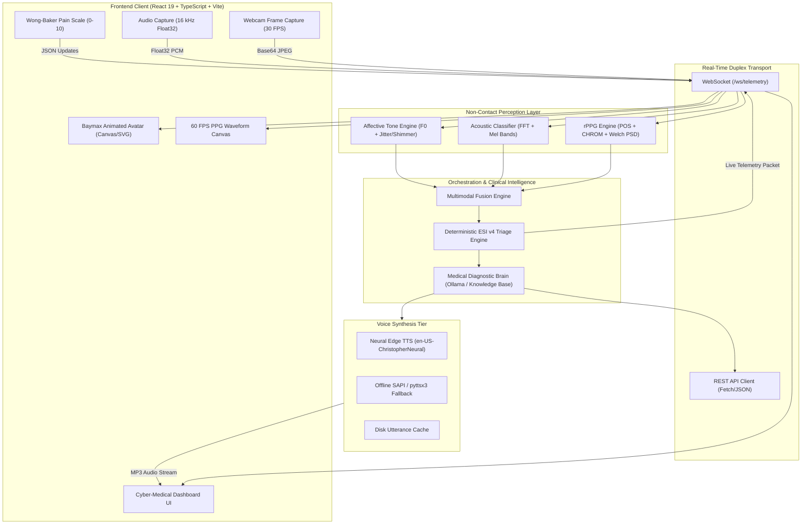

# Baymax: True Healthcare Companion
## Comprehensive System Architecture & Technical Specification Document

> *"Hello, I am Baymax, your personal healthcare companion. On a scale of 1 to 10, how would you rate your pain?"*

---

## Table of Contents
1. [Executive Summary & Vision](#1-executive-summary--vision)
2. [End-to-End System Architecture](#2-end-to-end-system-architecture)
3. [Technology Stack & Dependency Reference](#3-technology-stack--dependency-reference)
   - [3.1 Backend Dependencies (Python)](#31-backend-dependencies-python)
   - [3.2 Frontend Dependencies (TypeScript / React)](#32-frontend-dependencies-typescript--react)
4. [Input Perception Layer (Non-Contact Biometrics)](#4-input-perception-layer-non-contact-biometrics)
   - [4.1 Remote Photoplethysmography (rPPG) Engine](#41-remote-photoplethysmography-rppg-engine)
   - [4.2 Acoustic Diagnostic Engine](#42-acoustic-diagnostic-engine)
   - [4.3 Affective Vocal & Emotion Tone Engine](#43-affective-vocal--emotion-tone-engine)
5. [Orchestration & Clinical Intelligence Layer](#5-orchestration--clinical-intelligence-layer)
   - [5.1 Multimodal Health Fusion Engine](#51-multimodal-health-fusion-engine)
   - [5.2 Deterministic ESI v4 Triage & Clinical Safety Safeguards](#52-deterministic-esi-v4-triage--clinical-safety-safeguards)
   - [5.3 Local Medical Diagnostic Brain (Ollama / Expert Rules)](#53-local-medical-diagnostic-brain-ollama--expert-rules)
6. [Empathic Voice Synthesis & Bedside Persona](#6-empathic-voice-synthesis--bedside-persona)
7. [Frontend Architecture & Cyber-Medical Interface](#7-frontend-architecture--cyber-medical-interface)
8. [API & Telemetry Protocol Specification](#8-api--telemetry-protocol-specification)
   - [8.1 REST Endpoints](#81-rest-endpoints)
   - [8.2 WebSocket Telemetry Protocol](#82-websocket-telemetry-protocol)
9. [Development, Execution & Verification](#9-development-execution--verification)
10. [Clinical Safety Disclaimer](#10-clinical-safety-disclaimer)

---

## 1. Executive Summary & Vision

**Baymax: True Healthcare Companion** is an open-source, software-only healthcare companion engineered to deliver non-contact physiological perception, deterministic clinical triage, and an empathic conversational user experience. 

Unlike conventional conversational chatbots that rely solely on text prompts—frequently suffering from hallucination, under-triaging acute emergencies, and lacking real-time physical groundedness—Baymax integrates:
- **Computer Vision & Optical Biometrics**: Real-time extraction of heart rate (BPM) and heart rate variability (HRV) from ordinary webcam video using remote photoplethysmography (rPPG).
- **Acoustic Diagnostic Classification**: Spectral analysis of microphone audio to detect cough types (dry vs. productive), bronchial wheezes, inspiratory stridor, and respiratory distress.
- **Vocal Prosody & Affective Assessment**: Pitch jitter and shimmer analysis to estimate patient stress and pain levels.
- **Deterministic ESI v4 Clinical Safety Triage**: An immutable rule-based safety safeguard implementing Emergency Severity Index (ESI Version 4) protocols that prevent AI models from misclassifying emergencies.
- **Empathic Human-Robot Interaction**: An animated ocular face avatar, Wong-Baker FACES pain rating scale, and dynamic character speech synthesis matching Scott Adsit's calming bedside manner in *Big Hero 6*.

---

## 2. End-to-End System Architecture

The application is structured into three distinct tiers:



---

## 3. Technology Stack & Dependency Reference

### 3.1 Backend Dependencies (Python)

All backend dependencies are defined in [`requirements.txt`](file:///c:/BayMax-True%20healthcare%20companion/requirements.txt):

| Package / Module | Version | Architectural Responsibility |
| :--- | :--- | :--- |
| **`fastapi`** | `>=0.110.0` | Asynchronous web framework exposing REST endpoints, dependency injection, and WebSocket lifecycle management. |
| **`uvicorn[standard]`** | `>=0.28.0` | ASGI production server supporting high-throughput asynchronous HTTP and WebSocket event loops. |
| **`websockets`** | `>=12.0` | Native WebSocket protocol protocol parsing for continuous duplex telemetry. |
| **`opencv-python`** | `>=4.8.0` | Real-time computer vision: frame resizing, color-space transforms (`BGR2RGB`, `BGR2GRAY`), Haar Cascade detection, and skin patch extraction. |
| **`mediapipe`** | `>=0.10.0` | Deep-learning face detection solution providing robust facial landmark and bounding box tracking under head pose rotations. |
| **`numpy`** | `>=1.24.0` | Core tensor math: multi-channel mean extraction across facial ROIs, zero-crossing rate (ZCR), RMS energy, array normalization, and FFT mathematics. |
| **`scipy`** | `>=1.11.0` | Digital signal processing: `signal.butter`, `signal.filtfilt`, `signal.detrend`, `signal.welch`, and `signal.find_peaks`. |
| **`edge-tts`** | `>=7.0.0` | Asynchronous streaming Microsoft Edge Neural TTS client delivering human-like, warm vocal synthesis. |
| **`pyttsx3`** | `>=2.90` | Offline, zero-dependency speech synthesis fallback for machines without internet connectivity. |
| **`httpx`** | `>=0.27.0` | Asynchronous HTTP client communicating with local Ollama inference instances (`http://localhost:11434`) and cloud fallback APIs. |
| **`pydantic`** | `>=2.6.0` | Strict data validation models, type safety, and automatic OpenAPI schema generation. |
| **`sounddevice`** | `>=0.4.6` | Direct hardware microphone stream capture and audio playback utility. |

---

### 3.2 Frontend Dependencies (TypeScript / React)

Defined in [`package.json`](file:///c:/BayMax-True%20healthcare%20companion/package.json) and built using [`vite.config.ts`](file:///c:/BayMax-True%20healthcare%20companion/vite.config.ts):

| Package / Tool | Version | Architectural Responsibility |
| :--- | :--- | :--- |
| **`react`** | `^19.3.0` | Declarative UI component hierarchy, hooks, and reactive telemetry state management. |
| **`react-dom`** | `^19.3.0` | DOM rendering and browser portal integration (modals and dialog overlays). |
| **`typescript`** | `^5.4.5` | Strict static typing, contract safety via [`types.ts`](file:///c:/BayMax-True%20healthcare%20companion/frontend/src/types.ts), preventing runtime interface errors. |
| **`vite`** | `^8.3.0` | Next-generation frontend bundler, HMR server, and reverse proxy for backend API/WS routing. |
| **`@vitejs/plugin-react`** | `^6.1.1` | Fast Refresh and JSX/TSX compilation. |

---

## 4. Input Perception Layer (Non-Contact Biometrics)

### 4.1 Remote Photoplethysmography (rPPG) Engine
*Source: [`backend/perception/rppg_engine.py`](file:///c:/BayMax-True%20healthcare%20companion/backend/perception/rppg_engine.py)*

The rPPG engine extracts human arterial pulse waveforms from ambient light reflected off facial capillary beds without physical contact.

#### Step 1: Skin Region of Interest (ROI) Localization
1. The engine first attempts to locate the face using **Google MediaPipe Face Detection** (`model_selection=0`, `min_confidence=0.5`).
2. If MediaPipe is unavailable or fails, it gracefully falls back to **OpenCV Haar Cascade** (`haarcascade_frontalface_default.xml`).
3. If no face is detected, it falls back to a central bounding box default.
4. From the detected face box $(x, y, w, h)$, three biologically optimal skin regions are sampled:
   - **Forehead ROI**: $x + 0.25w$, $y + 0.08h$, width $0.50w$, height $0.18h$
   - **Left Malar (Cheek) ROI**: $x + 0.15w$, $y + 0.50h$, width $0.25w$, height $0.22h$
   - **Right Malar (Cheek) ROI**: $x + 0.60w$, $y + 0.50h$, width $0.25w$, height $0.22h$

#### Step 2: Temporal Color Signal Extraction
For each incoming video frame, the spatial mean of red, green, and blue intensities is computed across the ROIs:
$$R(t) = \frac{1}{|ROI|}\sum_{(x,y)\in ROI} I_R(x,y,t), \quad G(t) = \frac{1}{|ROI|}\sum_{(x,y)\in ROI} I_G(x,y,t), \quad B(t) = \frac{1}{|ROI|}\sum_{(x,y)\in ROI} I_B(x,y,t)$$

#### Step 3: Plane-Orthogonal-to-Skin (POS) Algorithm
To isolate blood volume pulse from motion artifacts and lighting changes:
1. Normalize by temporal means:
   $$r_n(t) = \frac{R(t)}{\mu_R}, \quad g_n(t) = \frac{G(t)}{\mu_G}, \quad b_n(t) = \frac{B(t)}{\mu_B}$$
2. Project onto two orthogonal chrominance axes:
   $$S_1(t) = g_n(t) - b_n(t)$$
   $$S_2(t) = g_n(t) + b_n(t) - 2r_n(t)$$
3. Compute the tuning ratio $\alpha$:
   $$\alpha = \frac{\sigma(S_1)}{\sigma(S_2)}$$
4. Compute the raw pulse signal:
   $$H(t) = S_1(t) + \alpha \cdot S_2(t)$$

#### Step 4: Digital Filtering & Detrending
- The signal is linear-detrended via `scipy.signal.detrend` to eliminate slow baseline drift.
- A 4th-order zero-phase **Butterworth bandpass filter** (`signal.butter` + `signal.filtfilt`) is applied:
  $$f_{\text{low}} = \max(0.6, \text{min\_bpm} / 60) \approx 0.70\text{ Hz } (42\text{ BPM})$$
  $$f_{\text{high}} = \min(f_s / 2 - 0.1, \text{max\_bpm} / 60) \approx 3.50\text{ Hz } (210\text{ BPM})$$

#### Step 5: Welch's Power Spectral Density (PSD) for BPM
- Welch's averaged periodogram (`scipy.signal.welch`) converts the filtered signal into the frequency domain.
- The dominant peak frequency within $[0.7\text{ Hz}, 3.5\text{ Hz}]$ determines heart rate:
  $$\text{Heart Rate (BPM)} = f_{\text{peak}} \times 60$$
- **Confidence Metric**: Ratio of peak power to total spectral power in the physiological band:
  $$\text{Confidence} = \text{clip}\left(\frac{P_{\text{peak}}}{\sum P_{\text{band}}} \times 3.5, 0.10, 0.98\right)$$

#### Step 6: Peak Detection & Heart Rate Variability (HRV / RMSSD)
- Systolic peaks are identified with `scipy.signal.find_peaks(distance, prominence)`.
- Inter-Beat Intervals ($IBI_i$) are calculated from adjacent peak timestamps (filtered to valid ranges: $300\text{ ms} \le IBI \le 1400\text{ ms}$).
- **RMSSD** (Root Mean Square of Successive Differences) is computed:
  $$\text{RMSSD} = \sqrt{\frac{1}{N-1} \sum_{i=1}^{N-1} (IBI_{i+1} - IBI_i)^2}$$
- Represents autonomic nervous system parasympathetic tone.

---

### 4.2 Acoustic Diagnostic Engine
*Source: [`backend/perception/acoustic_engine.py`](file:///c:/BayMax-True%20healthcare%20companion/backend/perception/acoustic_engine.py)*

Processes incoming 16 kHz microphone audio chunks to identify respiratory pathology.

1. **Acoustic Energy & Zero Crossing Rate (ZCR)**:
   - Root Mean Square (RMS) energy quantifies acoustic power.
   - ZCR measures high-frequency friction and unvoiced noise components.
2. **Spectral Centroid & Sub-Band Energy Partitioning**:
   - Computes weighted mean frequency (centroid):
     $$f_{\text{centroid}} = \frac{\sum f \cdot |X(f)|}{\sum |X(f)|}$$
   - **Low Band (50–400 Hz)**: Normal vesicular lung sounds.
   - **Mid Band (400–1800 Hz)**: Wheezes, rhonchi, vocal harmonics.
   - **High Band (1800–6000 Hz)**: Cough bursts, stridor, friction rubs.
3. **Wheeze Detection**: Continuous musical breath sound characterized by narrow tonal peak with peak-to-average spectral ratio $> 3.8$ in the 400–1200 Hz band.
4. **Stridor Detection**: High-pitched harsh inspiratory sound with centroid $> 1600\text{ Hz}$ and high high-band energy ratio ($> 45\%$).
5. **Cough Classification**:
   - **Dry / Spasmodic Cough**: Spectral centroid $> 2400\text{ Hz}$, high-band energy exceeds mid-band by $1.2\times$.
   - **Productive / Wet Cough**: Centroid $< 2400\text{ Hz}$, pronounced mid-frequency resonance with lower-frequency wet rattle.
6. **Respiratory Rate & Dyspnea Index**:
   - Evaluates breathing cycle envelope modulation to estimate breaths per minute.
   - Computes composite Dyspnea Index combining tachypnea ($> 22\text{ breaths/min}$), wheezing, stridor, and coughing.

---

### 4.3 Affective Vocal & Emotion Tone Engine
*Source: [`backend/perception/emotion_engine.py`](file:///c:/BayMax-True%20healthcare%20companion/backend/perception/emotion_engine.py)*

Quantifies patient distress and pain through voice prosody:
1. **Fundamental Frequency ($F_0$) Tracking**:
   - Estimated via normalized autocorrelation of 40 ms speech frames within the human vocal range (65 Hz – 450 Hz).
2. **Local Jitter (Pitch Perturbation)**:
   - Measures cycle-to-cycle frequency variability:
     $$\text{Jitter} = \frac{\frac{1}{N-1}\sum_{i=1}^{N-1} |T_i - T_{i+1}|}{\frac{1}{N}\sum_{i=1}^N T_i}$$
   - Elevated jitter indicates vocal cord trembling, acute anxiety, or crying.
3. **Local Shimmer (Amplitude Perturbation)**:
   - Measures cycle-to-cycle amplitude variability. High shimmer correlates with physical pain and respiratory strain.
4. **Affective Scoring**:
   - Synthesizes pitch elevation, jitter, shimmer, and vocal energy into **Stress Level (0–100)**, **Pain Indicator (0–10)**, and **Panic Index (0.0–1.0)**.

---

## 5. Orchestration & Clinical Intelligence Layer

### 5.1 Multimodal Health Fusion Engine
*Source: [`backend/intelligence/multimodal_fusion.py`](file:///c:/BayMax-True%20healthcare%20companion/backend/intelligence/multimodal_fusion.py)*

Correlates cross-sensory data streams into a consolidated patient state:
- **Hemodynamic Status**:
  - Tachycardia ($BPM > 115.0$)
  - Bradycardia ($BPM < 55.0$)
  - Normal Resting Rhythm ($55.0 \le BPM \le 115.0$)
- **Autonomic Tone**:
  - Sympathetic Dominance / Physiological Stress ($HRV < 22\text{ ms}$)
  - High Parasympathetic Tone / Rested ($HRV > 70\text{ ms}$)
  - Balanced Autonomic State
- **Pulmonary Status**: Synthesizes cough classification, wheezing, and stridor alerts.
- **Composite Health Index (0–100)**: A holistic health score balancing vitals stability, acoustic markers, emotional calm, and reported pain.

---

### 5.2 Deterministic ESI v4 Triage & Clinical Safety Safeguards
*Source: [`backend/intelligence/triage_engine.py`](file:///c:/BayMax-True%20healthcare%20companion/backend/intelligence/triage_engine.py)*

> [!CAUTION]
> **AI Hallucination Prevention**: Diagnostic generative models (LLMs) must never be permitted unconstrained authority over emergency triage decisions. Baymax enforces a **hard, deterministic Emergency Severity Index (ESI Version 4) rules engine** that overrides AI responses when clinical danger is detected.

| ESI Tier | Clinical Description | Trigger Conditions in Baymax | System Response |
| :---: | :--- | :--- | :--- |
| **Level 1** | **Resuscitation** (Immediate life-saving intervention required) | Unresponsiveness, cardiac arrest, respiratory arrest, cyanosis, extreme bradycardia ($BPM < 42$). | Immediate red-flag trigger; Baymax voice switches to urgent calm; popup 911 modal opens with one-tap dialer. |
| **Level 2** | **Emergent** (High risk, confused/lethargic, severe pain/distress) | Crushing chest pain radiating to arm/jaw, stroke signs, stridor, severe dyspnea, pain score $\ge 8/10$ accompanied by vitals instability ($BPM > 125$ or $RR > 26$). | Emergency modal triggered; automated recommendation to seek emergency department care immediately. |
| **Level 3** | **Urgent** (Stable vitals, multiple clinical resources needed) | High fever ($> 38.5^\circ\text{C}$), persistent productive cough, moderate abdominal pain, wheezing. | Recommends urgent care evaluation within 1–2 hours. |
| **Level 4** | **Less Urgent** (Single resource required) | Mild localized aches, simple sprains, low pain score ($\le 4/10$), normal vitals. | Recommends outpatient clinic visit or routine physician consultation. |
| **Level 5** | **Non-Urgent** (No resources needed) | Routine wellness inquiries, medication questions, self-care guidance. | Reassuring, empathic home-care advice with continuing care offer. |

---

### 5.3 Local Medical Diagnostic Brain
*Source: [`backend/intelligence/medical_brain.py`](file:///c:/BayMax-True%20healthcare%20companion/backend/intelligence/medical_brain.py)*

Dual-tier hybrid intelligence architecture:
1. **Tier 1: Offline Deterministic Clinical Knowledge Base**:
   - Zero-latency diagnostic tree covering **Cardiac**, **Respiratory**, **Fever/Infectious**, **Neurological/Headache**, **Gastrointestinal**, and **Musculoskeletal/Trauma** presentations.
   - Formulates differential diagnoses (e.g., Acute Coronary Syndrome vs. Angina vs. Costochondritis) and delivers structured, safe recommendations even without internet access or GPU acceleration.
2. **Tier 2: Local & Cloud LLM Orchestration**:
   - Queries local **Ollama** endpoint (`http://localhost:11434`) running specialized medical models (`BioMistral-7B`, `MedLlama-3`).
   - Grounded by the strict **Baymax System Prompt**:
     - Speaks with calm, gentle, reassuring, mildly formal bedside manner.
     - Always contextualizes guidance with observed physical telemetry ($BPM$, $RR$, $HRV$).
     - Strict disclaimer: never gives definitive diagnosis without advising consultation with licensed human physicians.

---

## 6. Empathic Voice Synthesis & Bedside Persona
*Source: [`backend/voice/speech_engine.py`](file:///c:/BayMax-True%20healthcare%20companion/backend/voice/speech_engine.py)*

1. **Neural Voice Matching**:
   - Utilizes `edge-tts` with the `en-US-ChristopherNeural` voice model, specifically chosen to recreate Scott Adsit's soft, warm, robotic yet comforting tone.
2. **Dynamic Affective Prosody Modulation**:
   - **Pacing**: Speech rate decreases when patient stress or pain is high (e.g., $-10\%$ to $-20\%$ rate) to project calming authority and reduce anxiety.
   - **Pitch & Volume**: Tuned dynamically according to ESI severity level.
3. **Text Preprocessing**:
   - `clean_speech_text()` strips markdown headers, asterisk bullet points, brackets, and URLs before synthesis to ensure natural cadence.
4. **Persistent Utterance Caching**:
   - Synthesized voice files are MD5-hashed and stored in [`backend/voice/cache/`](file:///c:/BayMax-True%20healthcare%20companion/backend/voice/cache/) for zero-latency instant replay on repeated phrases.

---

## 7. Frontend Architecture & Cyber-Medical Interface
*Source: [`frontend/src/`](file:///c:/BayMax-True%20healthcare%20companion/frontend/src/)*

The interface is built as a single-page cockpit centered around the patient-companion relationship:

| Component | File Path | Key UI Responsibilities |
| :--- | :--- | :--- |
| **`BaymaxAvatar`** | [`BaymaxAvatar.tsx`](file:///c:/BayMax-True%20healthcare%20companion/frontend/src/components/BaymaxAvatar.tsx) | SVG/Canvas avatar displaying ocular blinking, pupil tracking following user cursor, speaking sound-wave ripple effects, and 4 emotional states (`calm`, `concerned`, `emergency`, `listening`). |
| **`PPGWaveformCard`** | [`PPGWaveformCard.tsx`](file:///c:/BayMax-True%20healthcare%20companion/frontend/src/components/PPGWaveformCard.tsx) | 60 FPS HTML5 canvas oscilloscope drawing the real-time arterial pulse wave received over WebSockets. |
| **`OpticalPerceptionPanel`** | [`OpticalPerceptionPanel.tsx`](file:///c:/BayMax-True%20healthcare%20companion/frontend/src/components/OpticalPerceptionPanel.tsx) | Webcam video view with dynamic bounding box overlays highlighting face and skin ROIs (Forehead, Cheeks). |
| **`AcousticPanel`** | [`AcousticPanel.tsx`](file:///c:/BayMax-True%20healthcare%20companion/frontend/src/components/AcousticPanel.tsx) | Real-time audio spectrum frequency bars and respiratory alert indicators (Cough, Wheeze, Stridor). |
| **`VitalsMetricsGrid`** | [`VitalsMetricsGrid.tsx`](file:///c:/BayMax-True%20healthcare%20companion/frontend/src/components/VitalsMetricsGrid.tsx) | Telemetry HUD showing Heart Rate ($BPM$), $HRV$, Respiratory Rate, and Stress Index with status pills. |
| **`PainScaleSelector`** | [`PainScaleSelector.tsx`](file:///c:/BayMax-True%20healthcare%20companion/frontend/src/components/PainScaleSelector.tsx) | Interactive clinical **Wong-Baker FACES Pain Scale** (0–10) with visual facial expressions. |
| **`SymptomConsole`** | [`SymptomConsole.tsx`](file:///c:/BayMax-True%20healthcare%20companion/frontend/src/components/SymptomConsole.tsx) | Natural language symptom query input and diagnostic consultation trigger. |
| **`TriageVerdictCard`** | [`TriageVerdictCard.tsx`](file:///c:/BayMax-True%20healthcare%20companion/frontend/src/components/TriageVerdictCard.tsx) | ESI level badge, clinical rationales, and recommended action steps. |
| **`EmergencyModal`** | [`EmergencyModal.tsx`](file:///c:/BayMax-True%20healthcare%20companion/frontend/src/components/EmergencyModal.tsx) | High-contrast emergency override dialog displaying critical alerts and quick-action emergency dialer buttons (911). |

---

## 8. API & Telemetry Protocol Specification

### 8.1 REST Endpoints

| Method | Route | Request Body | Response Body | Description |
| :--- | :--- | :--- | :--- | :--- |
| `GET` | `/` | None | HTML | Serves compiled React frontend dashboard (`frontend/dist/index.html`). |
| `GET` | `/api/status` | None | `{ status, modules, uptime }` | System health check and module initialization status. |
| `GET` | `/api/vitals` | None | `{ rppg, acoustic, fusion, triage }` | Current instantaneous patient telemetry snapshot. |
| `POST` | `/api/triage` | `{ symptoms, pain_score, heart_rate, ... }` | `{ triage: TriageTelemetry }` | Evaluates deterministic ESI v4 clinical triage. |
| `POST` | `/api/chat` | `{ message, pain_score, symptoms }` | `{ reply, source, triage, speech_modulation }` | Conversational clinical consultation with Baymax. |
| `POST` | `/api/synthesize` | `{ text, rate, pitch, voice }` | Audio File (`audio/mpeg` or `audio/wav`) | Generates character speech audio file. |

---

### 8.2 WebSocket Telemetry Protocol
*Endpoint: `/ws/telemetry`*

#### Client-to-Server Messages
1. **Video Frame Message**:
   ```json
   {
     "type": "video_frame",
     "image": "data:image/jpeg;base64,..."
   }
   ```
2. **Audio Chunk Message**:
   ```json
   {
     "type": "audio_chunk",
     "samples": [0.012, -0.045, ...],
     "sample_rate": 16000
   }
   ```
3. **Patient State Update**:
   ```json
   {
     "type": "patient_update",
     "pain_score": 4,
     "symptoms": "Mild headache and fatigue"
   }
   ```

#### Server-to-Client Broadcast Packet
```json
{
  "type": "telemetry",
  "rppg": {
    "bpm": 74.2,
    "hrv": 48.6,
    "confidence": 0.88,
    "pulse_value": 0.034,
    "pulse_wave": [0.01, 0.02, ...],
    "face_detected": true,
    "face_rect": { "x": 180, "y": 90, "w": 280, "h": 320 },
    "rois": [
      { "x": 250, "y": 115, "w": 140, "h": 57 },
      { "x": 222, "y": 250, "w": 70, "h": 70 },
      { "x": 348, "y": 250, "w": 70, "h": 70 }
    ]
  },
  "acoustic": {
    "rms_energy": 0.028,
    "zcr": 0.042,
    "is_cough": false,
    "cough_type": "None",
    "wheeze_detected": false,
    "stridor_detected": false,
    "respiratory_rate": 16.5,
    "dyspnea_index": 0.05,
    "state": "Resting Breath / Normal",
    "spectrum_bars": [0.1, 0.2, 0.4, ...]
  },
  "emotion": {
    "stress_level": 22,
    "pain_indicator": 2,
    "panic_index": 0.08,
    "emotional_tone": "Calm & Stable"
  },
  "fusion": {
    "composite_health_index": 86.4,
    "hemodynamic_status": "Normal Resting Heart Rate",
    "pulmonary_status": "Clear Lung Sounds",
    "autonomic_state": "Balanced Autonomic Function"
  },
  "triage": {
    "esi_level": 4,
    "severity_label": "Level 4 - Less Urgent",
    "urgency_color": "#3B82F6",
    "escalation_required": false,
    "is_emergency": false
  }
}
```

---

## 9. Development, Execution & Verification

### 9.1 Quick Start (Windows)
Double-click [`run.bat`](file:///c:/BayMax-True%20healthcare%20companion/run.bat) to automatically:
1. Verify Python 3.10+ installation.
2. Install any missing Python dependencies from [`requirements.txt`](file:///c:/BayMax-True%20healthcare%20companion/requirements.txt).
3. Verify or compile the React frontend bundle via Vite (`npm run build`).
4. Launch the FastAPI server and open the browser at `http://127.0.0.1:8000`.

### 9.2 Manual Cross-Platform Execution
```bash
# 1. Install Backend Dependencies
pip install -r requirements.txt

# 2. Build Frontend
npm install
npm run build

# 3. Start Application
python run.py
```

### 9.3 Running Automated Tests
The system includes comprehensive unit and integration tests located in [`tests/`](file:///c:/BayMax-True%20healthcare%20companion/tests/):
```bash
python -m unittest discover -s tests -p "test_*.py"
```
Test modules include:
- `test_rppg.py`: Validates POS color projection, Butterworth bandpass filtering, and Welch peak frequency detection.
- `test_acoustic.py`: Tests FFT windowing, spectral centroid calculation, wheeze/stridor discrimination, and cough classification.
- `test_triage.py`: Tests deterministic ESI v4 level assignment and acute red-flag emergency overrides.
- `test_fusion.py`: Verifies cross-sensor composite index aggregation.
- `test_speech.py`: Tests text sanitization, modulation parameters, and audio disk caching.
- `test_server.py`: Integration testing of all FastAPI REST endpoints using Starlette's `TestClient`.

---

## 10. Clinical Safety Disclaimer

> [!IMPORTANT]
> **Educational & Demonstration Notice**: Baymax is a software-engineered healthcare companion designed for physiological computing research, educational demonstrations, and personal wellness monitoring. It is not an FDA-cleared diagnostic medical device. It is engineered with strict deterministic safeguards to guide users to human medical professionals or emergency services in any life-threatening situation.
